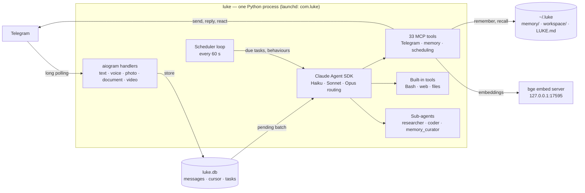

<div align="center">

# Luke

**A personal AI agent that lives on your Mac, talks to you on Telegram and remembers everything.**<br>
One Python process with long-term memory, its own schedule and loops that fix its own mistakes — for one person, running as a launchd service.

[Install](#install) · [How it works](#how-it-works) · [Memory](#memory) · [Self-improvement](#self-improvement)

</div>

---

> **Archived:** Luke has been superseded by [Theo](https://github.com/fpl0/theo), the new version of this project. Please use Theo for continued development and updates.

One person, one agent. Luke runs as a single Python process: he keeps memory across conversations, does real work (code, browsing, files, research), schedules his own follow-ups, and pings you only when something actually needs you.

- **Talks** — text, voice notes, photos, documents, videos and stickers over Telegram. Voice is transcribed on your Mac with Whisper; images and video frames go to Claude directly.
- **Remembers** — five types of long-term memory as Markdown files, indexed for keyword and semantic search, with a relationship graph and adaptive forgetting.
- **Acts** — 33 tools of his own on top of Claude Code's built-ins (Bash, web, files), plus three sub-agents for research, code and memory housekeeping.
- **Schedules** — cron, interval and one-shot tasks, and wakes himself up for autonomous work on his goals.
- **Routes** — picks Haiku, Sonnet or Opus per message based on cost and difficulty.
- **Improves himself** — analyses his own failures, writes the lesson down and patches his own code.

It is built to be **small enough to change**: no plugin system and no configuration sprawl. If you want different behaviour, you edit the code — fork it and make it yours.

## Contents

- [Install](#install)
- [What's inside](#whats-inside)
- [How it works](#how-it-works)
- [Self-improvement](#self-improvement)
- [Development](#development)
- [Project layout](#project-layout)
- [Known limitations](#known-limitations)
- [Credits and licences](#credits-and-licences)

## Install

Luke is set up by Claude Code itself: you clone the repo, open it in Claude Code and run one skill.

### Requirements

- macOS on Apple silicon (voice transcription uses [MLX](https://github.com/ml-explore/mlx))
- [Claude Code](https://claude.ai/download), and either a Claude subscription (Pro/Max) or an Anthropic API key
- Python 3.14 (pinned in `.python-version`; `pyproject.toml` requires `>=3.14`)
- [`uv`](https://docs.astral.sh/uv/) and `ffmpeg` (`brew install ffmpeg`)
- A Telegram bot token from [@BotFather](https://t.me/BotFather)

### 1. Clone

```bash
git clone https://github.com/fpl0/luke.git
cd luke
claude
```

### 2. Run /setup

In Claude Code, run:

```
/setup
```

That walks you through Python 3.14, `uv`, dependencies, Claude authentication, BotFather, chat ID detection, your name and timezone, and the launchd service. It writes everything to `.env` in the repo:

| Variable | What it is |
|---|---|
| `TELEGRAM_BOT_TOKEN` | Your bot's token from BotFather (required) |
| `CLAUDE_CODE_OAUTH_TOKEN` or `ANTHROPIC_API_KEY` | Claude authentication — one of the two (required) |
| `CHAT_ID` | The one Telegram chat Luke answers |
| `LUKE_DIR` | Where his data lives (default `~/.luke`) |
| `ASSISTANT_NAME` | Optional, default `Luke` |
| `MAX_CONCURRENT` | Optional, concurrent agent runs (default 8) |

> **Tip:** keep `LUKE_DIR` out of iCloud, Dropbox and Google Drive — SQLite databases can corrupt under cloud sync.

### 3. The launchd service

`/setup` fills in `com.luke.plist` and loads it as `~/Library/LaunchAgents/com.luke.plist`, so Luke starts at login and is restarted if he exits. To manage it by hand:

```bash
launchctl load ~/Library/LaunchAgents/com.luke.plist
launchctl unload ~/Library/LaunchAgents/com.luke.plist
launchctl kickstart -k gui/$(id -u)/com.luke   # restart

tail -f ~/.luke/luke.log                       # logs (default LUKE_DIR)
tail -f ~/.luke/luke.err
```

You can also send `/restart` or `/stop` (interrupt the current run) to the bot in Telegram.

## What's inside

### Memory

Markdown files with YAML frontmatter in `$LUKE_DIR/memory/`, indexed in SQLite FTS5 and [sqlite-vec](https://github.com/asg017/sqlite-vec). Five types, each with its own job:

| Type | Folder | What it holds |
|---|---|---|
| **Entities** | `entities/` | People, projects, concepts — evolve over time |
| **Episodes** | `episodes/` | Events, decisions, outcomes — accumulate |
| **Procedures** | `procedures/` | How-to knowledge, reusable scripts — stable |
| **Insights** | `insights/` | Patterns, preferences, rules — distilled |
| **Goals** | `goals/` | Active objectives with deadlines and progress |

Recall merges keyword and semantic results with Reciprocal Rank Fusion, follows links up to two hops, and scores by relevance, importance, recency and access. Importance decays hourly by type, slower for memories that keep getting used. A weekly consolidation pass distils insights and links related memories.

### Tools

Luke's own tools run in an in-process MCP server, alongside every Claude Code built-in.

| Group | Count | Tools |
|---|---:|---|
| Telegram | 15 | `send_message`, `send_photo`, `send_document`, `send_voice`, `send_video`, `send_location`, `send_poll`, `send_buttons`, `reply`, `forward`, `react`, `get_reactions`, `edit_message`, `delete_message`, `pin` |
| Memory | 9 | `remember`, `recall`, `recall_conversation`, `forget`, `connect`, `restore`, `bulk_memory`, `memory_history`, `review_corrections` |
| Scheduling | 3 | `schedule_task`, `list_tasks`, `delete_task` |
| Attention | 2 | `pin_attention`, `unpin_attention` — commitments that stay in context until cancelled |
| Monitoring | 2 | `get_cost_report`, `log_deep_work_quality` |
| Web | 1 | `browse` — open a page with Playwright and extract its text, optionally a screenshot |
| Delegation | 1 | `delegate` — a durable background job that survives restarts |

Sub-agents: **researcher** (web research), **coder** (write, edit and test code in the workspace) and **memory_curator** (consolidate, retag and link memories).

### Skills

Claude Code skills in `.claude/skills/` guide common changes:

| Skill | What it does |
|---|---|
| `/setup` | First-time installation |
| `/upgrade` | Pull latest, sync deps, apply migrations, restart |
| `/customize` | Add capabilities, change behaviour |
| `/debug` | Troubleshooting: logs, environment, Telegram issues |

## How it works



- **Telegram front end** (`src/luke/app.py`) — aiogram handlers store every incoming message in SQLite, then dispatch a background run. Messages that arrive while Luke is busy accumulate and are handled as one batch. Delivery is at-least-once: the cursor only advances on success, failed batches retry with backoff up to 3 times, and anything pending at a crash is replayed on restart. Only the configured `CHAT_ID` is answered.
- **Agent** (`src/luke/agent.py`) — the Claude Agent SDK client, the 33 MCP tools, the three sub-agents and the hooks that gate outbound messages (`src/luke/critic.py`, `src/luke/state_reconcile.py`). Each message is classified by effort and routed to Haiku, Sonnet or Opus.
- **Context** (`src/luke/context.py`) — assembles one budget of pinned continuity, query-ranked memories and standing context for every run.
- **Memory** (`src/luke/memory.py`) — FTS5 and semantic search, graph traversal, scoring and decay. Embeddings come from `scripts/bge_embed_server.py` (BAAI/bge-base-en-v1.5 on port 17595); if it is down, recall falls back to keyword search and missing vectors are backfilled hourly.
- **Scheduler** (`src/luke/scheduler.py`) — ticks every 60 seconds and wakes at once when a task is created or anything connects to `$LUKE_DIR/luke.sock`. Runs due tasks, hourly maintenance and the autonomous behaviours, and writes the heartbeat the watchdog reads.
- **Behaviours** (`src/luke/behaviors.py`, `src/luke/planner.py`) — consolidation, reflection, proactive scans, dreams, skill extraction and deep work on goals.
- **Media** (`src/luke/media.py`) — image encoding, video frames via `ffmpeg`, and voice transcription with `mlx-whisper` (`whisper-large-v3-turbo`).
- **Supervision** (`guardian.sh`, `watchdog.sh`, `deadman.sh`) — the guardian reverts HEAD after 3 crashes in 5 minutes on the same commit; the watchdog restarts Luke if the heartbeat is 30 minutes stale; the deadman messages you directly over the Telegram Bot API if he stays down past 45 minutes.

Data lives outside the repo in `$LUKE_DIR` (default `~/.luke`): `LUKE.md` (persona, seeded from `src/luke/templates/` if absent), `context.yaml` (your name and timezone), `luke.db`, `memory/` and `workspace/` (media, apps, scripts and plans Luke builds).

## Self-improvement

When something breaks, Luke is expected to fix the cause, not log it. A failed task, a claim that turned out to be wrong, a session that landed badly — each is an event that starts a loop, and the loop is only finished when code changed.

| Loop | Fires on | Produces |
|---|---|---|
| **Reflexion** | A specific failure | Root cause → an insight → usually a patch |
| **Reflection** | Weekly | Patterns across feedback, distilled into rules |
| **Dream** | Idle time | Defects found by cross-reading memory |
| **Skill extraction** | Repeated manual work | A reusable procedure or script |
| **Plan momentum** | A stalled goal | Unblocks it, or marks it honestly as blocked |

Three things keep that from becoming journalling:

- **A lesson has to graduate into a mechanism.** Prose gets forgotten the next time it matters. A repeat failure is supposed to end up as a test, a gate or a script that runs — not a paragraph.
- **Circuit-breakers run before the analysis.** Reflexion won't spawn on an empty payload or a failure mode it has already saturated, so it can't burn tokens relearning what it knows.
- **Sessions are graded 1–5 on whether the work landed**, not on how much was produced. An average below 1.5 over the last three sessions pauses the goal: something is structurally wrong and retrying is the wrong move.

Luke also runs several sessions at once, so each one starts by being told which workspace files a sibling touched in the last 20 minutes — and is steered onto different work rather than racing it.

## Development

```bash
uv run luke                              # run
uv run ruff check src/ tests/            # lint
uv run ruff format src/ tests/           # format
uv run mypy --strict src/luke/ tests/    # type check
uv run pyright src/ tests/               # type check (second opinion)
uv run pytest                            # test
```

All five checks must pass before a commit. They are gates, not suggestions — if one fails, fix the cause rather than silencing it. The suite has about 1,300 tests across 30 files in `tests/`.

| Script | What it does |
|---|---|
| `deploy.sh [branch]` | Runs the tests, merges to `main`, waits for Luke to go idle, restarts him and rolls back if he doesn't come up within 90 s |
| `guardian.sh` | Entry point for `com.luke`; crash-loop detection and auto-revert, then `uv run luke` |
| `watchdog.sh` | Restarts Luke on a stale heartbeat (`com.luke.watchdog`, every 2 minutes) |
| `deadman.sh` | Telegram alert when Luke is down and can't recover (`com.luke.deadman`, every 5 minutes) |
| `scripts/bge_embed_server.py` | Local embeddings server for memory (`com.luke.bgeembed`) |
| `scripts/eval_injection.py` | Replays real queries to compare memory-ranking changes offline |
| `scripts/p4_resume_canary.sh` | Daily SDK canary for session resume on cheaper models (`com.luke.p4canary`) |

## Project layout

```
src/luke/             the agent — app, agent, memory, context, scheduler, behaviours, media, db
src/luke/templates/   seed persona (LUKE.md), context.yaml example and output style
tests/                pytest suite, one file per module
scripts/              embeddings server, ranking replay and canary scripts
docs/                 design notes — memory, agent, concurrency, cursor model, security, persona
.claude/skills/       /setup, /upgrade, /customize and /debug for Claude Code
com.luke*.plist       launchd jobs — the agent, embeddings, watchdog, deadman, canary
*.sh                  guardian, watchdog, deadman and deploy scripts
```

## Known limitations

- **Archived:** Luke is no longer maintained. Issues and pull requests won't be picked up; see the notice at the top.
- **Single user:** one bot, one `CHAT_ID`. Messages from any other chat are ignored.
- **macOS only:** launchd runs the service and MLX does the transcription, so it needs a Mac on Apple silicon. Linux would mean replacing both.
- **Telegram only:** there is no other channel. Adding one means a new front end in `src/luke/app.py`.
- **Supporting launchd jobs are not installed by `/setup`:** `com.luke.bgeembed`, `com.luke.watchdog`, `com.luke.deadman` and `com.luke.p4canary` contain the original author's absolute paths. Edit them for your machine and load them yourself — without the embeddings server, recall is keyword-only.

## Credits and licences

Luke stands on a few open-source projects; each keeps its own licence.

- **Agent loop:** [Claude Agent SDK for Python](https://github.com/anthropics/claude-agent-sdk-python) (MIT).
- **Telegram:** [aiogram](https://github.com/aiogram/aiogram) (MIT).
- **Memory:** [sqlite-vec](https://github.com/asg017/sqlite-vec) (MIT / Apache-2.0), [FastEmbed](https://github.com/qdrant/fastembed) (Apache-2.0) with the [BAAI/bge-base-en-v1.5](https://huggingface.co/BAAI/bge-base-en-v1.5) model (MIT), and [scikit-learn](https://github.com/scikit-learn/scikit-learn) for clustering (BSD-3-Clause).
- **Media and web:** [mlx-whisper](https://github.com/ml-explore/mlx-examples) (MIT), [Pillow](https://github.com/python-pillow/Pillow) (MIT-CMU), [Playwright for Python](https://github.com/microsoft/playwright-python) (Apache-2.0).
- **Plumbing:** [pydantic-settings](https://github.com/pydantic/pydantic-settings) (MIT), [structlog](https://github.com/hynek/structlog) (MIT / Apache-2.0), [croniter](https://github.com/pallets-eco/croniter) (MIT), [PyYAML](https://github.com/yaml/pyyaml) (MIT).
- **Inspiration:** [NanoClaw](https://github.com/qwibitai/nanoclaw) — small, auditable, forkable agents.
- **Luke** itself is released under the [MIT licence](LICENSE), © 2026 Filipe Lima.
